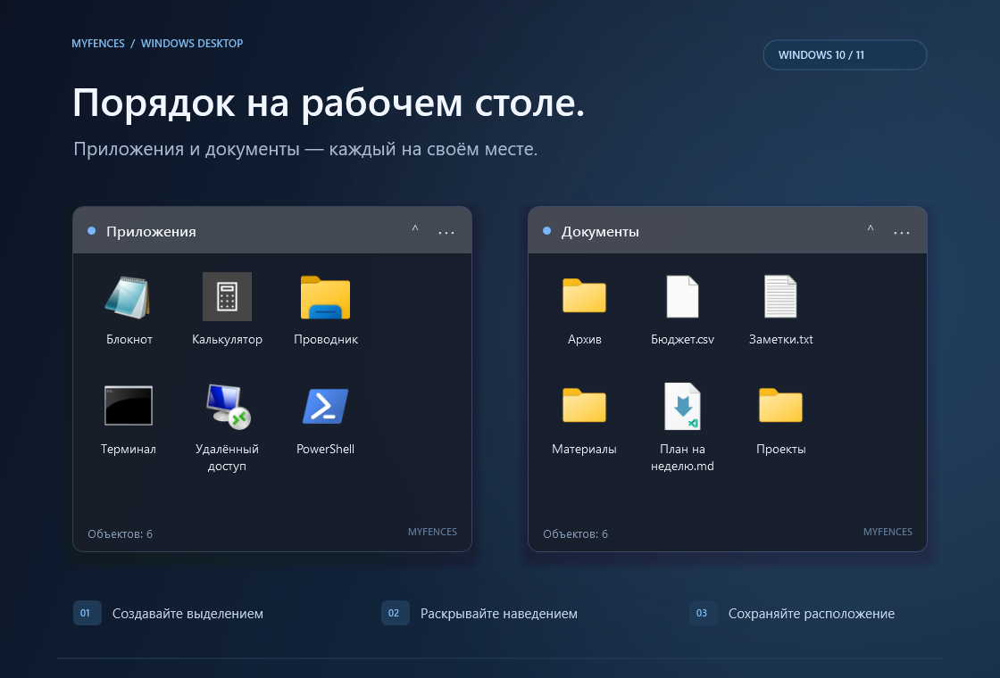
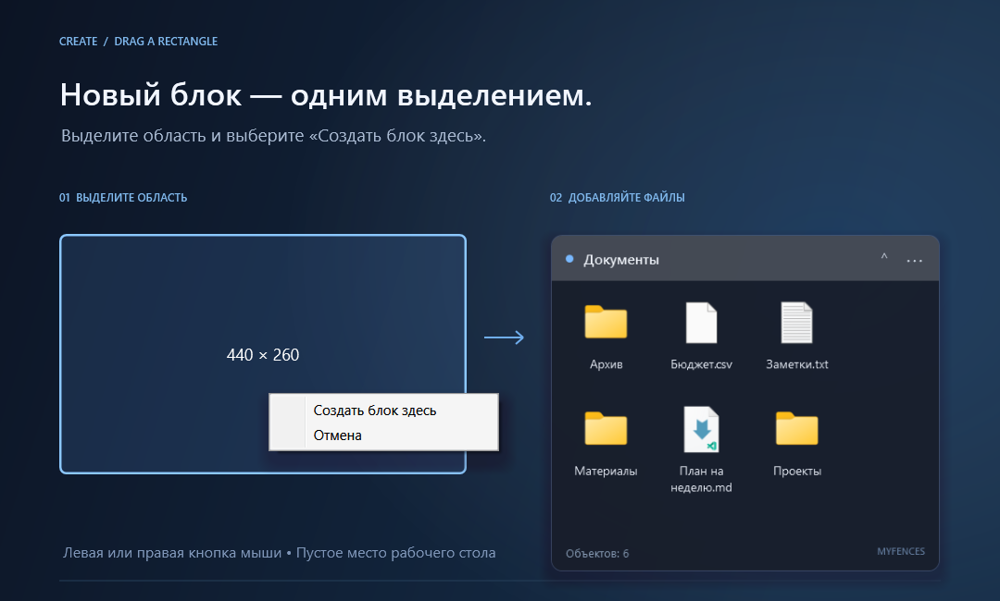
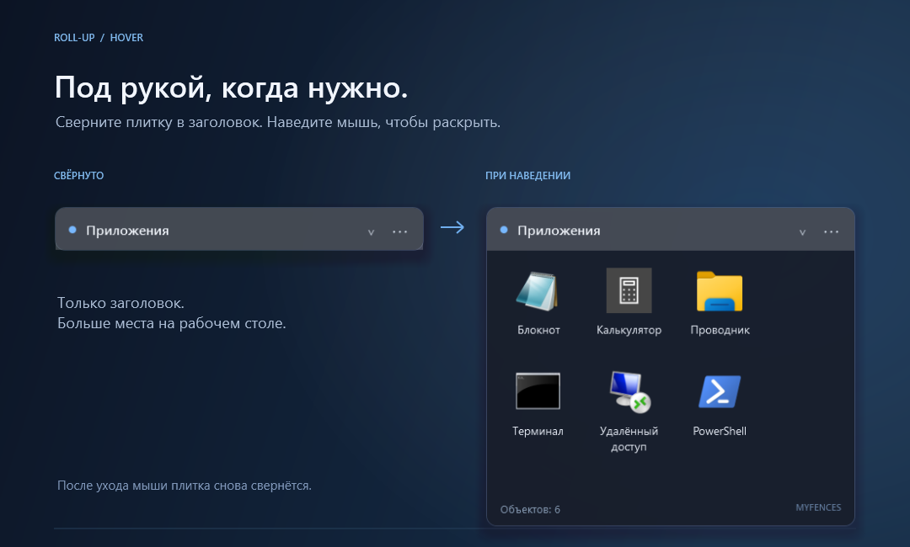

<div align="center">


# MyFences

**Рабочий стол, на котором всё на своём месте.**

Полупрозрачные плитки для приложений, файлов и проектов.<br>
Создавайте выделением мышью. Раскрывайте наведением. Сохраняйте порядок.

[](https://github.com/xenye1996-ship-it/MyFences/releases/latest)   

**[Скачать MSI](https://github.com/xenye1996-ship-it/MyFences/releases/download/v1.0.2/MyFences-1.0.2-win-x64.msi)** · **[Скачать ZIP](https://github.com/xenye1996-ship-it/MyFences/releases/download/v1.0.2/MyFences-1.0.2-win-x64.zip)** · [Все версии](https://github.com/xenye1996-ship-it/MyFences/releases) · [Сообщить об ошибке](https://github.com/xenye1996-ship-it/MyFences/issues)

</div>



MyFences организует рабочий стол Windows в отдельные блоки: приложения — в одном, документы — в другом, материалы проекта — рядом. Блоки можно свободно перемещать, менять их размеры и сворачивать в заголовок.

## Возможности

| | Что умеет MyFences |
|:--|:--|
| **Создание мышью** | Выделите прямоугольник на пустом рабочем столе и выберите «Создать блок здесь». |
| **Раскрытие при наведении** | Свёрнутый блок раскрывается под курсором и снова сворачивается после ухода мыши. |
| **Файлы и ярлыки** | Перетаскивание из Проводника, системные иконки, запуск двойным кликом и контекстное меню Windows. |
| **Границы экрана** | Плитки остаются в рабочей области монитора и не заходят под панель задач. Перенос между мониторами сохранён. |
| **Быстрое скрытие** | Двойной клик по пустому рабочему столу скрывает и возвращает все блоки. |
| **Автосохранение** | Названия, размеры, положение и свёрнутое состояние восстанавливаются при запуске. |

## Как это выглядит

<table>
  <tr>
    <td width="50%" valign="top">
      <strong>Создание выделением</strong><br>
      Выберите размер и положение нового блока прямо на рабочем столе.<br><br>
      <a href="docs/images/create-fence.png"></a>
    </td>
    <td width="50%" valign="top">
      <strong>Сворачивание и наведение</strong><br>
      Оставьте только заголовок, когда содержимое не нужно.<br><br>
      <a href="docs/images/rollup-hover.png"></a>
    </td>
  </tr>
</table>

<sub>На изображениях — настоящий интерфейс MyFences с демонстрационными файлами. Фон и поясняющие подписи добавлены для наглядности. Личные данные рабочего стола не использовались. Нажмите на изображение, чтобы рассмотреть детали.</sub>

## Установка за минуту

**Нужна Windows 10 или 11, x64. .NET уже включён в сборку.**

| Вариант | Как запустить |
|:--|:--|
| [**MSI — с установкой**](https://github.com/xenye1996-ship-it/MyFences/releases/download/v1.0.2/MyFences-1.0.2-win-x64.msi) | Запустите установщик. Он добавит MyFences для текущего пользователя и создаст ярлыки на рабочем столе и в меню «Пуск». |
| [**ZIP — без установки**](https://github.com/xenye1996-ship-it/MyFences/releases/download/v1.0.2/MyFences-1.0.2-win-x64.zip) | Распакуйте в постоянную папку и запустите `MyFences.exe`. |

После первого запуска появятся два блока. Меню приложения находится в системном трее: из него можно создать блок, показать все плитки, открыть хранилище или выйти.

EXE и MSI пока не имеют цифровой подписи.

## Управление

| Действие | Как выполнить |
|:--|:--|
| Создать блок | Выделить область левой или правой кнопкой на пустом рабочем столе → «Создать блок здесь». |
| Переместить / изменить размер | Потянуть за шапку / за край или угол. |
| Переименовать | Двойной клик по названию. `Enter` сохраняет, `Escape` отменяет. |
| Свернуть / развернуть | Двойной клик по свободной части шапки или кнопка `⌃`. |
| Временно раскрыть | Навести мышь на свёрнутый блок. После ухода курсора он свернётся через 350 мс. |
| Добавить файл или папку | Перетащить из Проводника или с рабочего стола в блок. |
| Открыть / вызвать меню файла | Двойной клик / правая кнопка по иконке. |
| Скрыть / вернуть все блоки | Двойной клик по пустому месту рабочего стола. |
| Открыть папку блока | Меню `⋯` → «Открыть папку блока». |

## Где находятся файлы

**Перетаскивание в блок физически перемещает файл в хранилище MyFences.** Это не дополнительная копия ярлыка на рабочем столе. При совпадении имён добавляется суффикс `(2)`, `(3)` и т. д.

```text
%APPDATA%\MyFences\
├── config.json        Настройки и расположение блоков
├── config.json.bak    Предыдущая версия настроек
├── Storage\<GUID>\    Файлы каждого блока
└── errors.log         Журнал ошибок
```

Чтобы вернуть файлы, откройте папку блока через `⋯` и перенесите их в Проводнике. Удаление блока или приложения **сохраняет файлы в хранилище**. Не удаляйте саму папку `Storage`, пока не забрали нужное содержимое.

<details>
<summary><strong>Для разработчиков</strong></summary>

Стек: **C# · WPF · .NET 8 · Win32 / P/Invoke**. Для сборки нужен .NET 8 SDK x64.

```powershell
dotnet build -c Release   # Собрать приложение
.\Build.ps1              # Автономный ZIP
.\Build-Msi.ps1          # MSI с помощью WiX 6.0.2
```

Скрипты используют локальный SDK из `.sdk`, если он установлен, иначе системный `dotnet`. WiX устанавливается в `.tools`. Результаты — в `artifacts`.

- [Сборка, проверки и ограничения](docs/DEVELOPMENT.md)
- [Отчёт о проверках](VERIFICATION.md)
- [Сборка релиза в GitHub Actions](https://github.com/xenye1996-ship-it/MyFences/actions/workflows/publish.yml)

Структура Explorer не является публичным контрактом Windows. Другие сборки ОС, смешанные DPI и сторонние оболочки требуют дополнительной проверки. Используется полупрозрачный Dark-стиль без Acrylic / Mica; автозапуск не включается.

</details>

---

MyFences — независимый проект организации рабочего стола. Не связан со Stardock и не является официальной версией Fences.
